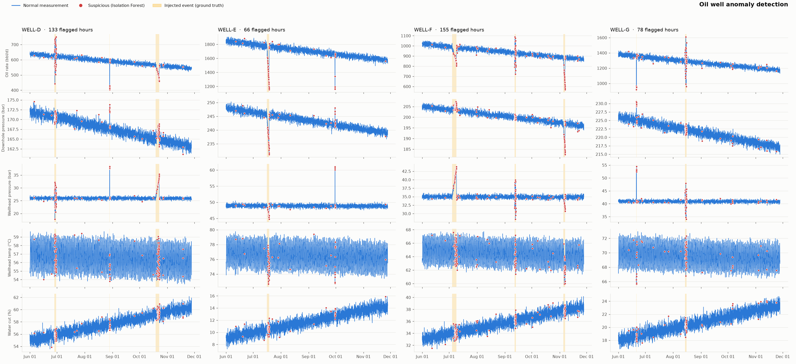

# Oil Well Anomaly Detector

Neft quyularının ölçmə datasında (hasilat, təzyiq, temperatur, su payı) qeyri-adi davranışı **Isolation Forest** ilə aşkarlayan və araşdırılmalı müşahidələri CSV hesabatına yazan layihə.



## Məqsəd

Ölçmə datasında (hasilat, təzyiq, temperatur, su payı) qeyri-adi davranışı aşkarlamaq və araşdırılmalı müşahidələri CSV-yə yazmaq. Əlavə məqsəd: metodun **zəif və yavaş** hadisələrdə necə işlədiyini yoxlamaq.

## Layihənin quruluşu

```
oilwell-anomaly-detector/
├── data/sample_data.csv               # 4 quyu × 180 gün, saatlıq (17 280 sətir)
├── notebooks/anomaly_detection.ipynb  # addım-addım analiz
├── src/detector.py                    # pipeline + CLI
├── outputs/
│   ├── anomaly_plot.png
│   ├── suspicious_observations.csv
│   └── anomaly_episodes.csv
├── requirements.txt
└── README.md
```

## Quraşdırma və istifadə

```bash
python3 -m venv .venv
source .venv/bin/activate
pip install -r requirements.txt

python src/detector.py --generate          # datanı yarat və analiz et
python src/detector.py                     # mövcud datanı analiz et
jupyter notebook notebooks/anomaly_detection.ipynb
```

Öz datanız üçün `--input path.csv` istifadə edin. CSV-nin formatı birinci layihədəki kimidir: `timestamp`, `well_id` və metrik sütunları.

## Data

Sintetik data [3W Dataset](https://github.com/petrobras/3W) siniflərinə əsaslanır, amma birinci layihədən fərqli hadisələrlə:

| Hadisə | 3W sinfi | Datada izi | Sayı |
|---|---|---|---|
| `flow_instability` | 4 — Flow Instability | təzyiq və hasilatda nizamsız, orta güclü salınmalar | 3 |
| `productivity_loss` | 5 — Rapid Productivity Loss | 2–2.5 gün ərzində hasilat −35%, quyudibi təzyiq −14 bar | 2 |
| `choke_restriction` | 6 — Quick Restriction in PCK | 1 saatda quyuağzı təzyiq +12 bar, hasilat −30% | 3 |
| `choke_scaling` | 7 — Scaling in PCK | 4–5 gün ərzində quyuağzı təzyiq +9 bar, hasilat −18% | 2 |

Real SCADA datasını təqlid etmək üçün dataya 515 boş dəyər, 25 dublikat və 12 sensor xətası əlavə olunub.

## Metod

Birinci layihə ilə eynidir:
- **Təmizləmə:** dublikatlar silinir, fiziki olaraq mümkün olmayan dəyərlər `NaN` edilir, ≤3 saatlıq boşluqlar interpolyasiya olunur.
- **Xüsusiyyətlər:** son 7 günün medianından sapma, 1 saatlıq dəyişmə və 6 saatlıq volatillik. Hamısı hər quyu üçün ayrıca robust z-score ilə miqyaslanır.
- **Model:** Isolation Forest, `contamination=0.025`.

Hər şübhəli saat üçün səbəb (`reason`) yazılır, ardıcıl şübhəli saatlar epizodlara birləşdirilir.

## Nümunə nəticə

| Göstərici | Ssenari 1 | **Ssenari 2** |
|---|---|---|
| Aşkarlanan hadisələr | 8 / 8 | **10 / 10** |
| Precision (saat) | 0.82 | **0.73** |
| Recall (saat) | 0.88 | **0.67** |
| Şübhəli saat / epizod | 216 / 9 | **432 / 92** |
| Yalançı epizodlar | 0 | **70** (hamısı 1–2 saatlıq) |

Hadisə növünə görə tutulan saatların payı:

| Hadisə | Tutulma |
|---|---|
| `flow_instability` | 94% |
| `choke_restriction` | 92% |
| `productivity_loss` | 62% |
| `choke_scaling` | 50% |

Ən yüksək skorlu epizodlar:

| Quyu | Başlanğıc | Saat | Əsas səbəb | Real hadisə |
|---|---|---|---|---|
| WELL-G | 2025-06-20 23:00 | 14 | quyuağzı təzyiq ↑ | ştuser daralması |
| WELL-E | 2025-09-30 04:00 | 11 | quyuağzı təzyiq ↑ | ştuser daralması |
| WELL-D | 2025-08-28 16:00 | 12 | quyuağzı təzyiq ↑ | ştuser daralması |
| WELL-G | 2025-08-14 07:00 | 42 | təzyiq və hasilat volatilliyi ↑ | axın qeyri-sabitliyi |
| WELL-D | 2025-06-28 09:00 | 48 | təzyiq və hasilat volatilliyi ↑ | axın qeyri-sabitliyi |

**Əsas nəticələr:**
- **Qəfil dəyişiklikləri asanlıqla tutur.** Ştuserin daralması və axın qeyri-sabitliyi 90%-dən çox tutulur.
- **Yavaş dəyişikliklərdə zəifdir.** Duz çökməsi və məhsuldarlıq itkisi bir neçə günə yayılır. 7 günlük baza xətti onlara uyğunlaşır, ona görə hadisənin yalnız bir hissəsi işarələnir.
